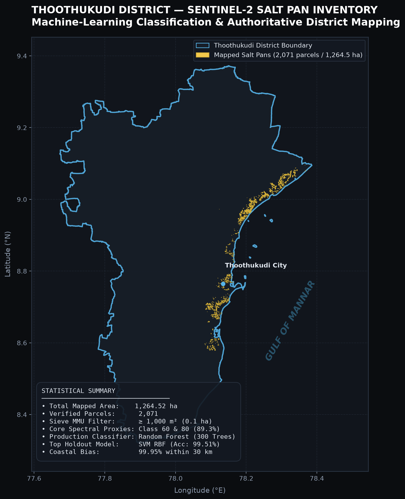
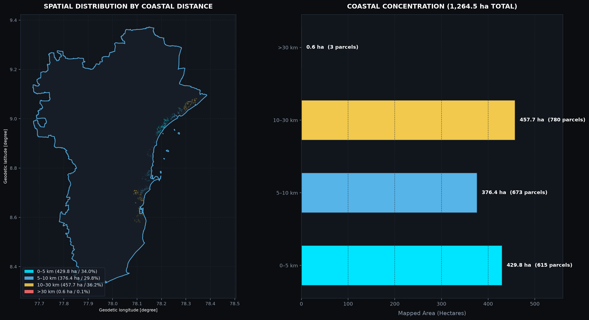
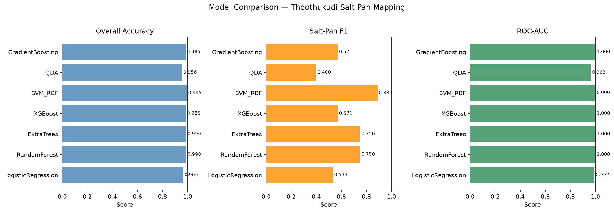
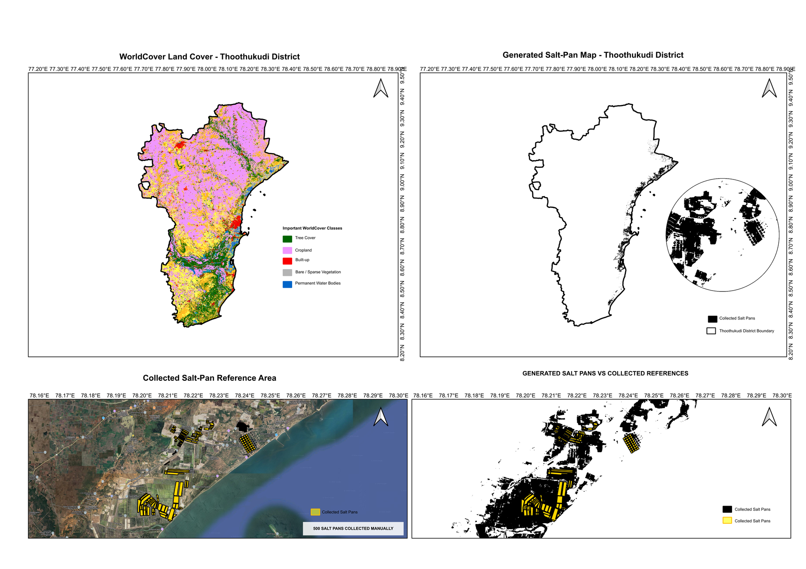

# Thoothukudi Salt Pan Intelligence
### *District Mapping & Machine-Learning Classification Analytics*

[](https://react.dev/)
[](https://www.typescriptlang.org/)
[](https://vitejs.dev/)
[](https://maplibre.org/)
[](https://sentinels.copernicus.eu/)
[](https://scikit-learn.org/)
[](LICENSE)

An interactive, high-performance geospatial analytics dashboard designed for district-level salt pan inventorying, spatial analytics, and machine-learning classification benchmarks across **Thoothukudi District, Tamil Nadu, India**.

---

## 📥 Downloadable Project Deliverables

| File | Description | Direct Download Link |
|:---|:---|:---:|
| **25-Slide PowerPoint Presentation (.pptx)** | Fully editable technical presentation with comprehensive speaker notes for academic review | [📥 Download PPTX (3.4 MB)](https://github.com/FarhanaazRS/thoothukudi-saltpan-mapping/raw/main/public/downloads/Thoothukudi_Salt_Pan_Mapping_Project_Presentation.pptx) |
| **Complete Slide Deck PDF (.pdf)** | High-resolution 25-slide vector PDF export with full maps and analytical charts | [📄 Download PDF (2.5 MB)](https://github.com/FarhanaazRS/thoothukudi-saltpan-mapping/raw/main/public/downloads/Thoothukudi_Salt_Pan_Mapping_Project_Presentation.pdf) |
| **District Salt Pan Inventory (GeoJSON)** | 2,071 vector parcels (1,264.52 ha) strictly clipped to Thoothukudi District | [🗺️ Download GeoJSON](https://github.com/FarhanaazRS/thoothukudi-saltpan-mapping/raw/main/public/data/saltpan_inventory.geojson) |

---

## 🗺️ Map Visualizations & Analysis

### 1. Authoritative District Salt Pan Inventory
The finalized vector inventory mapped from multi-temporal **Sentinel-2 MSI Level-2A** imagery strictly clipped to the Thoothukudi district administrative boundary.



### 2. Coastal Proximity Stratification & Concentration
Analysis of salt pan distribution relative to the Gulf of Mannar shoreline across four non-overlapping distance zones.



### 3. Machine Learning Benchmark Comparison
Performance metrics across all 7 evaluated classification algorithms on the spatial block holdout dataset ($N = 206$).



### 4. Official Cartographic Submission
Cartographic map output showcasing district-wide saltern complexes, tidal inlets, and evaporation crystallizers.



---

## 📊 Key Geospatial & ML Metrics

| Parameter | Value | Details / Provenance |
| :--- | :---: | :--- |
| **Total Salt Pan Area** | **1,264.52 ha** | Vector polygon sum strictly inside Thoothukudi District |
| **Total Verified Parcels** | **2,071** | Individual salt pan evaporation & crystallizer polygons |
| **Out-of-District Purged** | **-627 parcels (-367.44 ha)** | Regional tile artifacts in Ramanathapuram / Tirunelveli removed |
| **Minimum Mapping Unit (MMU)** | **$\ge 1,000\text{ m}^2$ (0.1 ha)** | Morphological sieve filter threshold to eliminate spatial noise |
| **Top Holdout Model** | **SVM (RBF Kernel)** | Accuracy: **99.51%**, Precision: **100%**, Recall: **80.00%**, F1: **88.89%** |
| **Production District Model** | **Random Forest (300 Trees)** | ROC-AUC: **1.000**, PR-AUC: **1.000**, Global Precision: **100%** |
| **Coastal Concentration** | **99.95%** within 30 km | 34.0% in 0–5 km, 29.8% in 5–10 km, 36.2% in 10–30 km |
| **ESA WorldCover Proxies** | **89.3%** | Class 60/62 (Bare soil/crust: 49.8%) & Class 80 (Open water: 39.5%) |

---

## 🚀 Dashboard Modules

The web dashboard is structured into 5 interactive feature views:

1. **Overview**:
   - WebGL-accelerated vector map powered by MapLibre GL JS with custom dark cartography (`#0B0D10` / `#14181E`).
   - High-contrast gold salt pan layer (`#F2C94C`) and official district boundary (`#56B4E9`).
   - Calibrated probability raster preview overlay and training parcel boundary toggle.
   - Interactive parcel inspector displaying ID, area, perimeter, and coastal proximity band.

2. **Salt Pan Explorer**:
   - Filterable data grid containing all **2,071 individual parcels**.
   - Search by Parcel ID, filter by coastal distance band (0–5km, 5–10km, 10–30km, >30km), and size class.
   - Dynamic 5-bin area distribution histogram.
   - One-click CSV export of filtered records.

3. **Model Lab**:
   - Comprehensive multi-algorithm benchmark table comparing:
     - *Random Forest* (300 trees, production classifier)
     - *Extra Trees* (300 trees)
     - *Gradient Boosting*
     - *XGBoost*
     - *Support Vector Machine (RBF Kernel)*
     - *Logistic Regression*
     - *Quadratic Discriminant Analysis (QDA)*
   - Interactive 2×2 confusion matrix inspector with TP, FP, TN, and FN breakdown.
   - Fitted Gini feature importance bar charts highlighting predictive bands (`B11_SWIR1`, `B08_NIR`, `B02_Blue`).

4. **Validation & Comparison**:
   - Dual-layer map comparison between reference training polygons and predicted vector inventory.
   - Sieve progression analysis documenting data transitions:
     - Raw classification: **1,415.92 ha** (35,398 pixels)
     - Cleaned raster: **1,362.60 ha** (34,065 pixels)
     - Final vector inventory: **1,264.52 ha** (2,071 polygons)
     - Spatial noise reduction: **151.40 ha (-10.69%)**.

5. **Area Analytics**:
   - Spatial stratification by coastal distance zones with interactive parcel filters.
   - Top 10 largest contiguous salt pan complexes ranked by area.
   - Land cover correlation against **ESA WorldCover 2021** (10m resolution).

---

## 🛠️ Tech Stack & Architecture

- **Frontend**: React 18, TypeScript 5.5, Vite 5.4.
- **Mapping Engine**: MapLibre GL JS 4.7.
- **Styling**: Vanilla CSS Design System with dark theme tokens (`#0B0D10`, `#14181E`, `#F2C94C`, `#56B4E9`).
- **Data Formats**: GeoJSON (polygons and lines), PNG raster overlays, structured JSON metadata.
- **Machine Learning**: Scikit-Learn, XGBoost, GeoPandas, Rasterio, Shapely.
- **Testing**: Vitest, React Testing Library (11 automated test suites).

---

## 💻 Local Development Setup

### Prerequisites
- [Node.js](https://nodejs.org/) (v18 or higher recommended)
- `npm` or `pnpm`

### Installation
```bash
# Clone repository
git clone https://github.com/FarhanaazRS/thoothukudi-saltpan-mapping.git
cd thoothukudi-saltpan-mapping

# Install dependencies
npm install

# Start Vite development server
npm run dev
```

The application will be live at: `http://localhost:5173/`

### Running Tests & Verification
```bash
# Run unit tests
npm test

# Build production bundle
npm run build
```

---

## 📁 Repository Structure

```
thoothukudi-saltpan-mapping/
├── public/
│   └── data/
│       ├── district_boundary.geojson      # Official Thoothukudi district polygon
│       ├── saltpan_inventory.geojson      # 2,071 clipped salt pan polygons
│       ├── reference_training_salt.geojson# 501 reference training parcels
│       ├── probability_preview_4326.png   # District-masked probability raster
│       ├── probability_bounds.json        # WGS84 raster georeference bounds
│       ├── coastal_summary.json           # 4-zone coastal proximity stats
│       ├── sieve_comparison.json          # Multi-stage post-processing stats
│       ├── worldcover_comparison.json     # ESA WorldCover 2021 cross-tabulation
│       ├── model_comparison.json          # 7-algorithm benchmark metrics
│       ├── confusion_matrices.json        # Holdout confusion matrices
│       ├── feature_importance.json        # Model feature importance weights
│       └── metadata.json                  # Authoritative dataset KPIs & metadata
├── screenshots/
│   ├── 01_district_saltpan_overview.png   # District salt pan inventory map
│   ├── 02_coastal_proximity_analysis.png  # Coastal buffer analysis
│   ├── 03_ml_model_benchmark.png          # Model evaluation chart
│   └── 04_mapathon_cartographic_map.png   # Presentation map
├── src/
│   ├── components/
│   │   ├── Shell.tsx                      # Header, sidebar, and layout shell
│   │   ├── Overview.tsx                   # Interactive MapLibre district map
│   │   ├── SaltPanExplorer.tsx            # Searchable 2,071-parcel table & histogram
│   │   ├── ModelLab.tsx                   # Algorithm benchmark & confusion matrix
│   │   ├── ValidationComparison.tsx       # Dual-layer reference vs predicted view
│   │   └── AreaAnalytics.tsx              # Coastal bands & WorldCover analytics
│   ├── state/
│   │   └── useDashboardData.ts            # Reactive JSON & GeoJSON data loaders
│   ├── config.ts                          # Map and data endpoint configuration
│   ├── types.ts                           # Comprehensive TypeScript domain models
│   ├── styles.css                         # Dark theme design system
│   ├── App.tsx                            # Root application component
│   └── main.tsx                           # Application entry point
├── tests/
│   ├── app.test.tsx                       # UI navigation and rendering tests
│   └── data.test.ts                       # Geospatial data integrity tests
├── index.html                             # Single-page application template
├── package.json                           # Dependencies and build scripts
├── tsconfig.json                          # TypeScript configuration
├── vite.config.ts                         # Vite bundler configuration
└── README.md                              # Project documentation
```

---

## 🛰️ Remote Sensing & GIS Provenance

- **Sensors Used**: Sentinel-2 MSI Level-2A (ESA Copernicus), 10m/20m multi-spectral resolution.
- **Spectral Bands**: Blue (B02), Green (B03), Red (B04), NIR (B08), SWIR-1 (B11), SWIR-2 (B12).
- **Land Cover Reference**: ESA WorldCover 2021 (v200) 10m land cover map.
- **Administrative Boundary**: Official Survey of India / District GIS vector boundaries for Tamil Nadu.

---

## 👩‍💻 Author & Contributions

**Farhanaaz RS**  
GitHub: [@FarhanaazRS](https://github.com/FarhanaazRS)  
Project: *Thoothukudi Salt Pan Intelligence & Machine-Learning Mapping*
